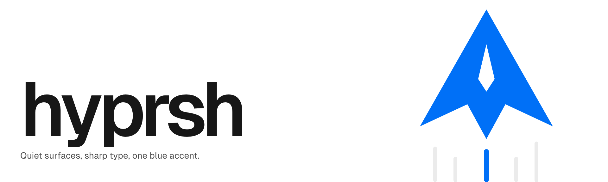

<picture>
  <source media="(prefers-color-scheme: dark)" srcset="docs/images/cover-dark.png">
  
</picture>

# hyprsh design system

90 accessible React components, design tokens, the Geist fonts and the hyprsh brand, in one package with no dependencies of its own. Light and dark themes, touch sizing and keyboard support are built in.

**[Docs and live examples](https://hyprsh.github.io/design/)** · **[Releases](https://github.com/hyprsh/design/releases)** · **[Getting started](docs/getting-started.md)**

## Get started

**1. Install** a release tag (React 18 or newer is a peer dependency):

```bash
npm install github:hyprsh/design#v0.16.0
```

**2. Import the styles** once, at your app's entry:

```tsx
import '@hyprsh/design/tokens.css';
import '@hyprsh/design/styles.css';
```

Using Tailwind v4? Import the Tailwind entry instead of those two files. It also gives you the design's colours, radii, shadows and type styles as utilities (`bg-background-100`, `text-gray-900`, `label-14`…):

```css
@import "tailwindcss";
@import "@hyprsh/design/tailwind.css";
```

**3. Use the components:**

```tsx
import { Button, Input, Toast, useToasts } from '@hyprsh/design';

export default function App() {
  const toasts = useToasts();

  return (
    <>
      <form onSubmit={(e) => { e.preventDefault(); toasts.success('Domain added'); }}>
        <Input label="Domain" placeholder="example.com" hint="Point its DNS at your project first." />
        <Button typeName="submit" variant="primary">Add Domain</Button>
      </form>
      {/* Mount one <Toast /> at the app root; toasts from anywhere show here. */}
      <Toast />
    </>
  );
}
```

**Dark mode:** set `data-theme="dark"` (or a `.dark` class) on `<html>` or any ancestor. Without it, the light theme applies.

Every component has a page with live examples you can copy at **https://hyprsh.github.io/design/**.

## What's inside

| | |
|---|---|
| **Components** | Forms (Input, Select, Combobox, Checkbox, Toggle, Slider…), overlays (Modal, Drawer, Popover, Menu, Command Menu, Tooltip), data (Table, Query Bar, File Tree, JSON View, Column Chart, Bar List, Sparkbars), feedback (Toast, Banner, Note, Progress, Skeleton), navigation (Nav List…), layout and media. Each one ships its TypeScript types. |
| **Tokens** | A colour scale for light and dark, spacing, radii, shadows, z-index and type styles, as CSS variables and classes (`.heading-24`, `.copy-14`). |
| **Fonts** | Geist Sans and Geist Mono, loaded by `tokens.css`. |
| **Icons** | Pass any [Lucide](https://lucide.dev) icon: `<Icon icon={GitBranch} />` from `lucide-react`. `import '@hyprsh/design/icons'` registers the full set for `<Icon name="…">` (about 450 KB). |
| **Brand** | The logo SVGs: `@hyprsh/design/brand/logo-mark.svg`, `logo-mark-mono.svg` and `logo-lockup.svg`. |
| **Guidelines** | Interface rules for accessibility, forms, motion and copy in [project/guidelines.md](project/guidelines.md), and the brand book in [project/README.md](project/README.md). |

## Using it with coding agents

The package ships an `AGENTS.md` with the setup, the hard rules and an index of every component, plus one markdown file per component that matches the installed version. Add this line to your app's `CLAUDE.md` or `AGENTS.md`:

```
UI comes from @hyprsh/design. Read node_modules/@hyprsh/design/AGENTS.md before writing UI.
```

The docs site also serves `llms.txt`, `llms-full.txt` and a `.md` version of every page.

## Without a bundler

`project/components/bundle.js` is a classic script that puts every component on `window.Hyprsh`, for plain HTML pages. See [Using the bundle in plain HTML](docs/getting-started.md#using-the-bundle-in-plain-html).

## Upgrading

Each version is a git tag. [CHANGELOG.md](CHANGELOG.md) (the [Changelog page](https://hyprsh.github.io/design/changelog/), and `docs/changelog.md` in the package) and the [GitHub releases](https://github.com/hyprsh/design/releases) list each version's features, fixes and breaking changes. To upgrade, point the install at the new tag:

```bash
npm install github:hyprsh/design#v0.16.0
```

---

## Working on the design system

The design system is also published as a Design System artifact; the `project/` folder is exactly what gets published. Node 20 or newer is all you need (22 or newer for the scripts that drive Chrome). There is nothing to install.

### Layout

```
project/
  README.md            brand book: colour, type, layout, materials, motion, iconography, copy
  guidelines.md        interface rules (accessibility, forms, motion, performance…)
  tokens.json          colour (light + dark), shadows, spacing, radius, z-index, type styles, fonts
  design-system.json   manifest
  fonts/               Geist + Geist Mono variable woff2 (SIL OFL 1.1)
  brand/               logo SVGs: the delta starship mark (blue and mono) and the lockup
  components/
    src/               component sources (one .js/.css/.d.ts per component, plus core and icons)
    <Name>/            README.md (usage) + preview.html (the live card)
    Cover/             the artifact's cover card
    bundle.js          built: window.Hyprsh, one classic script
    bundle.css         built
    index.d.ts         built: <Name>Props for every component
scripts/
  build.mjs            builds the bundle and checks every component against the artifact contract
  package.mjs          builds the npm package into dist/ (ES module, types, styles, tokens, Tailwind entry, fonts, logo)
  dev.mjs              local card viewer, light and dark side by side
  shot.mjs             headless Chrome mount check + screenshots into .cache/shots
  cards.mjs            checks every card fits its declared height
  icons.mjs            vendors Lucide into src/_icons.js
  tokens-css.mjs       compiles tokens.json to CSS the way the artifact does
  site.mjs             builds the docs site into .cache/site (--serve to view it)
  examples.mjs         mounts every docs example in headless Chrome
  smoke.mjs            loads dist/index.js against React 18 and 19 in headless Chrome
  release-notes.mjs    writes a tag's GitHub release notes from the commits since the previous tag
docs/
  getting-started.md   the docs site home page, also shipped to coding agents
  adr/                 architecture decisions
```

### Commands

| Command | What it does |
|---|---|
| `npm run build` | Builds the artifact bundle and the package in `dist/`. |
| `npm test` | Runs the unit tests. |
| `npm run dev` | The card viewer at http://127.0.0.1:4400. Add `?only=Button,Toggle` to show just those cards. |
| `npm run site` | Builds the docs site into `.cache/site`. Add `-- --serve` to serve it at http://127.0.0.1:4401. |
| `node scripts/examples.mjs` | Checks that every docs example mounts. |
| `node scripts/cards.mjs [Name …]` | Checks that every card fits the `height` on line 1 of its preview.html at 960px, in light and dark: fails when content is clipped, warns on a big empty band. Serves the cards itself. |
| `npm run shots -- Button Toggle` | Mount check and light and dark screenshots of those cards. Needs `npm run dev` running. |
| `node scripts/mobile.mjs Button Toggle` | Renders cards at 375px with touch, flags anything wider than the screen and tap targets under 24px, and saves screenshots to `.cache/mobile`. |
| `node scripts/touch.mjs` | Measures touch sizing at 1280px with a mouse, at 375px and with a coarse pointer, and fails when a drawn size or hit area is off (see Touch sizing in `project/guidelines.md`). |
| `node scripts/smoke.mjs [18\|19]` | Loads `dist/index.js` the way an app does, on React 18 and 19 from esm.sh, and fails on an error, a `console.error`, a component that didn't render or a missing toast. Run `npm run build` first; it needs network access. |
| `node scripts/chrome.mjs --clean` | Kills headless Chrome processes left behind by a killed Chrome script (only those whose profile is a `hy-chrome-*` directory in the OS temp dir) and deletes their profiles. |

The Chrome scripts need Google Chrome installed in `/Applications`, or `CHROME_PATH` set. They clean up after themselves when they exit or are interrupted, and stop with exit code 1 after `HY_DEADLINE` seconds (default 600, `0` for no limit), so they need no `timeout` wrapper.

### Releasing

From a clean `main` that is level with `origin/main`, run `node scripts/release.mjs 0.17.0 --push`. It first checks that the tree is clean, the version is greater than `package.json`'s and the tag is new, and that CI on `origin/main`'s HEAD is green (it refuses a red run, and asks you to try again while one is still going; `--skip-ci-check` overrides that). Then it bumps `version` in `package.json` and the install tags in this README and `docs/getting-started.md`, adds the version to the changelog with `node scripts/release-notes.mjs --changelog v0.17.0` (a new section at the top of `CHANGELOG.md` from the commits since the latest tag, dated today, with the older sections untouched), commits it all as `chore: release 0.17.0`, tags `v0.17.0` and pushes `main` and the tag. Without `--push` it stops before pushing and prints the push command, and `--dry-run` prints the plan and the diff and changes nothing. The changelog comes first because the docs site and the npm package are built from the committed `CHANGELOG.md`. Pushing the tag runs every check, deploys the docs site and publishes a GitHub release with the same notes, grouped from the commit subjects since the previous tag, so write them as conventional commits (`feat(table): …`, `fix: …`, `feat!: …` for breaking changes). A test fails when an install tag or the changelog disagrees with `package.json`'s version.

### Contributing

See [CONTRIBUTING.md](CONTRIBUTING.md) for the component conventions, the preview and README formats, and how to check your work.

## Licence

MIT, see [LICENSE](LICENSE). It also credits the parts by others (fonts, icons, the interface guidelines), which keep their own licences.
